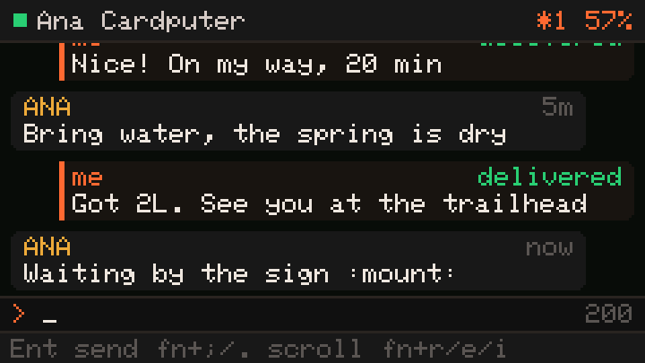
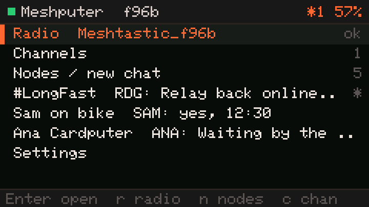
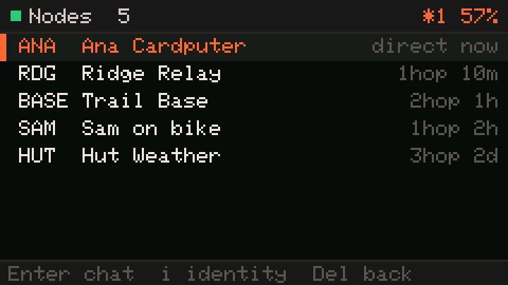
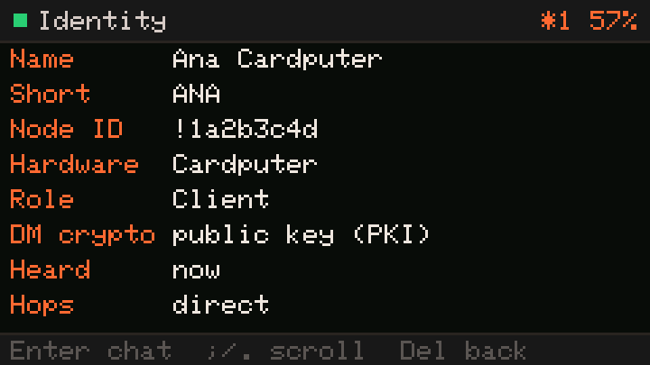
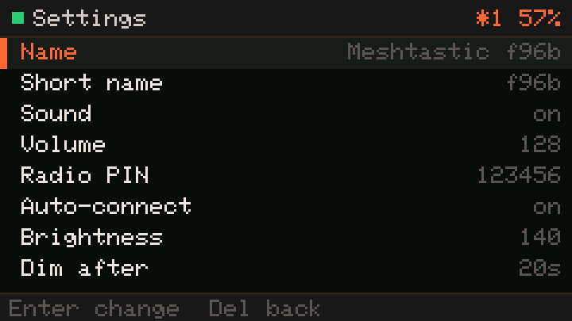
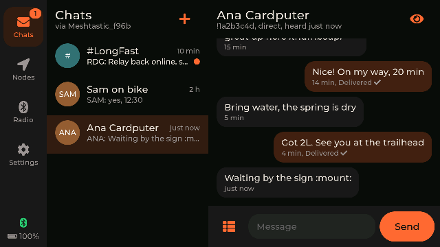
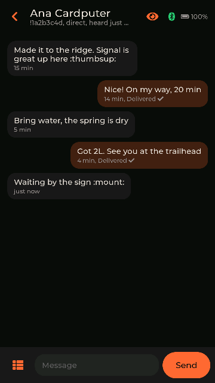

<h1 align="center">Meshputer</h1>

<p align="center">
  <b>A Meshtastic messenger for the M5Stack Cardputer and Tab5.</b><br>
  Pair it over Bluetooth with the Meshtastic radio you already own and chat over LoRa from a real keyboard or a touch screen.
</p>

<p align="center">
  <a href="https://dvorson.github.io/meshputer/"><b>⚡ Install from your browser</b></a> ·
  <a href="https://github.com/Dvorson/meshputer/releases/latest">Download</a> ·
  <a href="#using-it">Keys</a> ·
  <a href="#tab5">Tab5</a> ·
  <a href="#development">Hack on it</a>
</p>

<p align="center">
  <a href="https://github.com/Dvorson/meshputer/actions/workflows/ci.yml"></a>
  <a href="https://github.com/Dvorson/meshputer/releases/latest"></a>
  <a href="LICENSE"></a>
</p>

<p align="center"></p>

## Why

Meshtastic radios are great, but you normally drive them from a phone. Meshputer
turns a Cardputer or a Tab5 into the radio's keyboard and screen instead:

- **Works with the radio you have.** Heltec, T-Beam, RAK, T-Echo, Station G2… any
  Meshtastic node with Bluetooth, on stock firmware. No LoRa add-on needed.
- **Works on both Cardputers and the Tab5.** Original Cardputer (v1.1) and
  Cardputer ADV with their keyboards; the Tab5 with a touch UI of its own.
- **Leaves the phone at home.** A pocket messenger with a physical keyboard.

Already have a Cardputer ADV with the Cap LoRa-1262? You can also run a full node
on it ([official Mesh Kit firmware](https://docs.m5stack.com/en/core/Cardputer_Mesh_Kit),
[Plai](https://github.com/d4rkmen/plai)). Meshputer is for the other case: a
radio on your belt or backpack, and the Cardputer in your hand.

## Features

- 📡 **Find & pair** radios nearby with their PIN; reconnects by itself after reboots and dropouts
- 💬 **Direct messages and channels**, with `sent` → `relayed` → `delivered` status from mesh ACKs
- 🪪 **Identity**: see who anyone is (name, id, hardware, role, hops, signal, battery, PKI encryption) and **edit your own name** — written to your radio and announced to the mesh
- 💾 **History on SD**, kept per radio
- 😀 **Emoji** sent as real emoji (phones see them) plus quick replies
- 🌐 **Internet DMs (prototype)**: a Nostr identity on the device; private messages (NIP-17) with any Nostr app over Wi-Fi when you're out of LoRa range — off by default
- 🔋 **Battery first**: 80 MHz CPU, Wi-Fi off unless you turn Internet on, Bluetooth only when needed, slow BLE interval once synced, screen dims then sleeps

<p align="center">
  
  
  
  
</p>

## Tab5

On the M5Stack Tab5 Meshputer has a touch UI of its own, built with LVGL and
designed for the 5" screen rather than scaled up from the Cardputer:

- **Turns with the device.** Hold it sideways for chats, nodes and settings side by
  side with a navigation rail; upright for one page at a time with a bottom bar.
  (Settings → Display can pin it to portrait or landscape.)
- **Chats** for DMs, channels and internet DMs, with an on-screen keyboard that
  docks under the conversation and quick replies one tap away.
- **Nodes** with each node's identity and signal and a *Message* button;
  **Radio** to scan, pair (PIN keypad) and connect; **Settings** for your name,
  internet chats with a QR code of the device's Nostr identity, display and sound.
- History is kept on the microSD card, or in internal flash when there is none.

<p align="center">
  
  
</p>

The Tab5's Wi-Fi and Bluetooth radio is an ESP32-C6 reached over SDIO, so it runs
the arduino-esp32 Bluetooth stack; the Cardputer keeps NimBLE.

## Install

**Browser (recommended):** open **[dvorson.github.io/meshputer](https://dvorson.github.io/meshputer/)**
in desktop Chrome or Edge, plug the Cardputer or Tab5 in, press *Install*; it picks
the right firmware for the device. Updates keep your paired radio and settings.

**Single image:** grab `meshputer-cardputer-<version>.bin` or
`meshputer-tab5-<version>.bin` from
[Releases](https://github.com/Dvorson/meshputer/releases/latest) for M5Burner,
M5Launcher (as full firmware) or esptool:

```bash
esptool.py --chip esp32s3 write_flash 0x0 meshputer-cardputer-v0.3.0.bin
esptool.py --chip esp32p4 write_flash 0x0 meshputer-tab5-v0.3.0.bin
```

**From source:** see [Development](#development).

Then on the Tab5: *Radio* → *Scan*, tap your radio, and type its PIN if asked.
On the Cardputer: **Enter** on *Connect a radio*, pick yours, type its PIN
(pre-filled with Meshtastic's default `123456`; radios with a screen show a random
one). Close the phone app first: a radio talks to one Bluetooth client at a time.

## Using it

On the Cardputer:

| Where | Keys |
|---|---|
| Lists | `;` `.` up/down, **Enter** open, **Del** or `` ` `` back |
| Home | `r` radio, `n` nodes (start a DM), `c` channels, `s` settings |
| Chat | type, **Enter** send, **Del** on empty line = back, `fn`+`;`/`.` scroll, `fn`+`r` quick replies, `fn`+`e` emoji, `fn`+`i` who is this |
| Nodes | **Enter** chat, `i` identity |

**Two Cardputers** chat like any two Meshtastic users: pair each with its own
radio on the same channel settings, open *Nodes*, pick the other one, type.

**Your name:** Settings → *Name* / *Short name*. It's saved on your radio
(Meshtastic `set_owner`), read back to confirm, and broadcast so others see it.

## Internet DMs over Nostr (prototype)

Off by default. In Settings set *Wi-Fi* and *Wi-Fi password*, then switch
*Internet* on. The Cardputer gets its own [Nostr](https://nostr.com) identity
(*Nostr ID* shows it as a QR code) and:

- publishes a profile named after your radio, linking the npub to your Meshtastic node id and key,
- receives and sends private DMs (NIP-17, NIP-44 encryption) with any Nostr app that supports them — e.g. Amethyst, 0xchat,
- talks to public relays (`nos.lol`, `relay.primal.net`); no server of yours, nothing to host.

Internet chats appear on Home as `@name`. Limits of this prototype: one relay
connection at a time (TLS memory next to Bluetooth, no PSRAM), relay TLS
certificates are not verified yet (messages are still end-to-end encrypted and
signed), and new internet chats start from the other side or via the console
(`nostr dm <npub> <text>`).

## How it saves power

| Part | Policy |
|---|---|
| Wi-Fi | off unless you turn *Internet* on; powered down again when you turn it off |
| Bluetooth | on only while scanning, connecting, connected, or waiting to reconnect; off otherwise |
| BLE link | fast interval while syncing the node list, then 120–160 ms |
| CPU | 80 MHz; the main loop sleeps between polls |
| Display | dims after 20 s, sleeps after 60 s (configurable); a new message lights it dimmed |
| Speaker | amplifier powered only while a tone plays |

## Development

Needs [uv](https://docs.astral.sh/uv/).

```bash
make setup      # PlatformIO + tool deps
make test       # native unit tests (protocol, conversations, text, Nostr) — no device needed
make interop    # Nostr DMs cross-checked against rust-nostr, both directions
make flash      # build + flash over USB (BOARD=tab5 for the Tab5)
make logs       # stream device logs
```

The firmware exposes a serial console, so you can drive and inspect a device from a script:

```bash
make console CMD='status nodes'
make console CMD='"send !a1b2c3d4 hello" "owner ANA Ana Cardputer"'
make shot OUT=screen.png        # what's on the display, as PNG (Tab5: STEP=2 for half size)
make screenshots                # regenerate docs/screens on demo data (RAM only; BOARD=tab5)
```

`help` lists every command (`scan`, `connect`, `pin`, `nodes`, `node`, `send`,
`owner`, `key` to inject key presses, `tap`/`swipe`/`rotate` on the Tab5, `shot`, …).
Each ends with `## done` or `## error <why>`.

```
src/core/       portable C++ (no Arduino): Meshtastic protobuf framing,
                conversation model + SD format, UTF-8/emoji text — unit tested
src/            device layer: BLE client (NimBLE or arduino-esp32 stack behind
                ble_link.h), chat service, Nostr, power, boards
src/screens/    Cardputer: keyboard screens and navigation
src/tab5/       Tab5: LVGL touch UI (shell, views, display/touch/IMU port)
tests/          native tests for src/core, against the real nanopb schema
tools/          serial console/screenshot tool, release + installer-site builders
web/            browser-installer page (GitHub Pages)
```

Releases: push a `v*` tag; CI builds both boards, attaches their images to a GitHub
Release and publishes the installer to Pages (`make site` + `make serve` to preview locally).

### Notes

- Uploads use `--no-stub`: esptool's RAM stub is unreliable over the S3's USB-JTAG port.
- Opening the serial port with RTS asserted and DTR released resets the ESP32-S3; the tool keeps DTR asserted.
- History lives in `/meshputer/<node id>/` on the SD card, one text file per conversation
  (Tab5 without a card: the same layout in internal flash).
- Tab5 text uses LVGL's built-in Latin fonts, so emoji show as `:codes:` as on the Cardputer.
- If a radio was reflashed and refuses the old pairing, Meshputer drops the bond and pairs again; *Forget radio* does it by hand.

## License

GPL-3.0, like the Meshtastic protobufs it builds on. Meshtastic® is a registered
trademark of Meshtastic LLC; this project is not affiliated with it.
